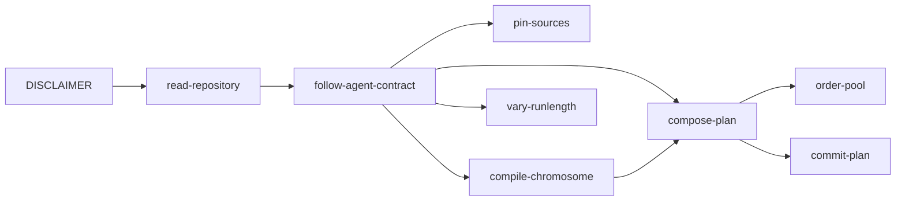

# `read-repository` — where to start

`type: resource.router` · `spec: agent.router` · subordinate to `docs/follow-agent-contract.md`, which governs on any conflict.

tesseract compiles one DNA target into the parts a machine can actually synthesize, and composes those parts back into the exact target. It is a specbase with one reference implementation, `ref/tess.py` (Python, standard library only).

## Specification

```json { type: notebook.cell }
{
  "id": "docs/read-repository.md",
  "type": "resource.router",
  "role": "send each task down the smallest sufficient path",
  "reads": ["DISCLAIMER", "task"],
  "writes": [],
  "must": ["read DISCLAIMER first", "stop at the first sufficient row"],
  "check": ["route row exists", "Graph reciprocity"]
}
```

## Graph

- → [follow-agent-contract.md](follow-agent-contract.md)

## Route

Read `DISCLAIMER` before any node. Then take the first row that covers the task and stop.

| Task | Path |
|---|---|
| Know what a `.tess` file is | `tesseract.md` |
| Compile a target into parts | contract §1–§3 → `skills/compile-chromosome.md` |
| Check a plan, or rebuild its target | contract §4 → `skills/compose-plan.md` |
| Compare machines before compiling | contract §6 → `ref/tess.py project` |
| Turn a plan into an oligo order | `systems/order-pool.md` |
| Attach a plan to a chromosome page, or put one on chain | `systems/commit-plan.md` |
| Know why a cut was placed where it was | contract §7 |
| Know why a target was refused | contract §5 |
| Check whether a source may be used | `docs/pin-sources.md` |
| Understand the runlength bet | `docs/vary-runlength.md` |
| Traverse without reading prose | `ooc/tesseract.og` |
| Anything else, or a conflict | `docs/follow-agent-contract.md` |

## Reading order



## Licence

MIT, see `LICENSE`. Sources are cited and pinned, not vendored.
